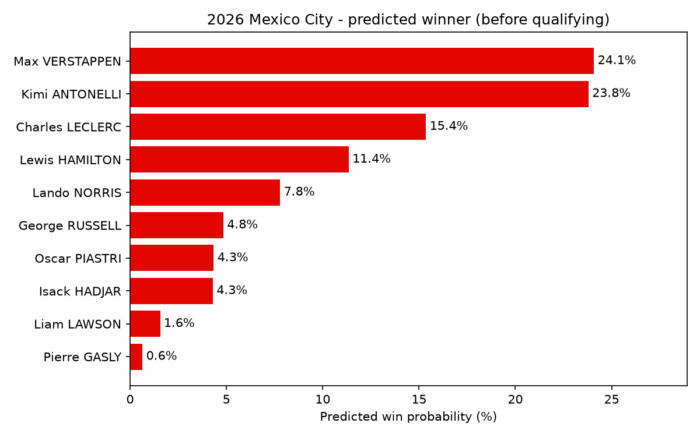
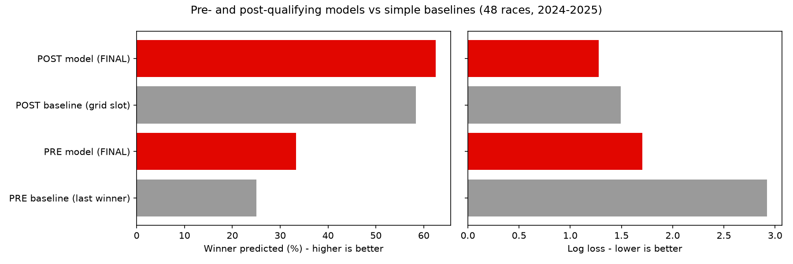
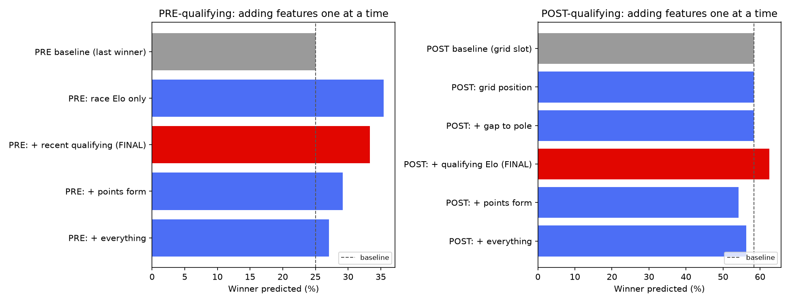
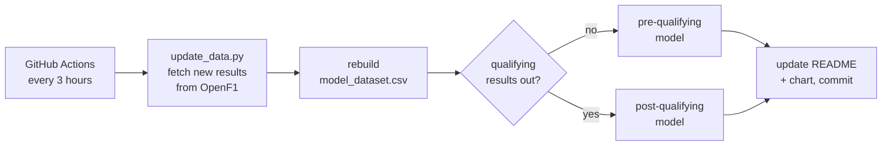

# F1 Race Winner Predictor


Predicts who will win each Formula 1 Grand Prix, using only **qualifying results and race history** - no practice sessions, tyre data or weather.

There are two models:

- **Pre-qualifying** - who's likely to win before the weekend's qualifying has happened
- **Post-qualifying** - updated once the grid is set on Saturday

The prediction below updates itself every race weekend. A GitHub Actions job pulls the latest data from the OpenF1 API every 3 hours and switches from the pre- to the post-qualifying model as soon as the qualifying results are published.

<!-- LIVE-PREDICTION:START -->
## Live prediction: 2026 Austin

**Predicted winner: Kimi ANTONELLI** (53% chance), predicted after qualifying using the post-qualifying model: grid position, gap to pole, qualifying Elo.

| # | Driver | Team | Win chance |
|---|---|---|---|
| 1 | Kimi ANTONELLI | Mercedes | 53% |
| 2 | Max VERSTAPPEN | Red Bull Racing | 20% |
| 3 | Charles LECLERC | Ferrari | 9% |
| 4 | Lewis HAMILTON | Ferrari | 6% |
| 5 | Isack HADJAR | Red Bull Racing | 5% |



_Updated automatically 25 Oct 2026 01:33 UTC_
<!-- LIVE-PREDICTION:END -->

## Results

Tested on all **48 races of 2024 and 2025**, predicting each race using only the races that came before it (see [how it's tested](#how-its-tested)).

| Model | Winner predicted | Winner in top 3 | Log loss (lower is better) |
|---|---|---|---|
| Pre-qualifying baseline: *last race's winner wins again* | 25.0% | 25.0% | 2.92 |
| **Pre-qualifying model** | **33.3%** | **72.9%** | **1.70** |
| Post-qualifying baseline: *how often each grid slot wins* | 58.3% | 87.5% | 1.49 |
| **Post-qualifying model** | **62.5%** | **87.5%** | **1.28** |



- Both models beat their baseline, and a bootstrap test (10,000 resamples of the 48 races) shows the improvement is very unlikely to be luck: p = 0.003 for post-qualifying, p < 0.001 for pre-qualifying.
- The post-qualifying model got 58% of winners right in 2024 and 67% in 2025.
- Pole position wins about 58% of the time on its own, so the post-qualifying model's job is mostly spotting *when* the pole sitter is likely to lose - and giving sensible odds to everyone else.

**What didn't help** (also useful to know):

| Tried | Result |
|---|---|
| Adding points form (driver and team) | Worse - 54% instead of 62.5% |
| Adding every feature | Worse - 56% |
| XGBoost instead of the simple model | Worse - 60.4%, log loss 1.43 |
| Plain logistic regression | Same as the final model |

With only ~70 races to learn from, a small model with a few good features beats a big one. Full comparison in [`results/feature_comparison.csv`](results/feature_comparison.csv).



## Data

All data comes from the free [OpenF1 API](https://openf1.org). No API key is needed.

| Endpoint | What I use it for |
|---|---|
| `/sessions` | race weekend calendar - dates, circuits, which sessions have finished |
| `/session_result` | qualifying positions and lap times (Q1/Q2/Q3), race finishing positions |
| `/drivers` | driver names, codes (VER, HAM...) and teams |

- **Seasons:** 2023 to now (87 races and 1,771 driver-race rows as of October 2026, growing each weekend)
- Raw API responses are saved as CSVs in `data/raw`, so each run only downloads new sessions
- The processed table the models train on is `data/processed/features/model_dataset.csv` - one row per driver per race

## Features

| Feature | Model | What it means |
|---|---|---|
| `race_elo_rel` | Pre | Elo rating built from past race finishes, relative to the best-rated driver in the race |
| `quali_pos_last5` | Pre | Average qualifying position over the driver's last 5 races |
| `log_quali_pos` | Post | Grid position (log, because P1 vs P2 matters far more than P15 vs P16) |
| `quali_gap_capped` | Post | % behind the pole lap, measured within the last Q session the driver reached, capped at 2% |
| `quali_elo_rel` | Post | Elo rating built from past qualifying results, relative to the best-rated driver |

**Elo ratings** work like chess ratings: after each session, every pair of drivers is treated as a head-to-head, and beating a highly rated driver earns more than beating a backmarker. Ratings are always taken *before* each race, so a race's own result never leaks into its features.

**Gap to pole** is measured within each driver's last qualifying segment, because the track gets faster during qualifying - at Hungary 2025, Norris's Q2 lap was quicker than Leclerc's pole lap in Q3.

## How the model works

Both models are a **conditional logit** - logistic regression where the drivers in each race compete against each other:

1. Each driver gets a score: `score = w1 × feature1 + w2 × feature2 + ...`
2. A softmax over the drivers in that race turns scores into win chances that always add up to 100%
3. Training finds the weights that make the actual winners as likely as possible, with an L2 penalty so it doesn't memorise a small dataset

This fits the problem better than a standard classifier: there's exactly one winner per race, and a driver's chances depend on who they're up against.

## How it's tested

**Walk-forward testing**: for each of the 48 races in 2024-2025, the model is trained only on races before it, then predicts that race. This is exactly how it's used for real, and it means it never sees the future.

Other things I checked to keep it honest:

- **No data leakage** - Elo ratings and form averages only use earlier races; ties in the rankings are broken alphabetically, never by grid position (which a pre-qualifying model can't know)
- **Baselines** - each model has to beat a simple rule, not just look good on its own
- **Features chosen on 2024, confirmed on 2025** - so the final features aren't just the lucky combination out of hundreds tried

## The live pipeline



- Results are only saved 6 hours after a session ends, because penalties and disqualifications can change them
- The README is only committed when the prediction actually changes
- Every live prediction is logged in [`results/live_predictions.csv`](results/live_predictions.csv), so the 2026 season can be scored on races the model had never seen

## Run it yourself

```bash
git clone https://github.com/gurjeevansatnam/f1-race-performance-predictor.git
cd f1-race-performance-predictor
pip install -r requirements.txt

python src/data/update_data.py        # get the latest data and build the dataset
python src/models/evaluate.py         # walk-forward test of all 4 models
python src/models/analysis.py         # luck check, feature + model comparison, charts

# predict a race
python src/models/predict.py --stage post --year 2026 --race "Austin"            # live
python src/models/predict.py --stage pre --backtest "2025 Yas Marina Circuit"    # a past race
```

## Project structure

```
src/
├── data/
│   ├── openf1_client.py         # API calls - retries, rate limits, saves responses
│   ├── update_data.py           # fetches new races + rebuilds everything
│   └── ...                      # session / race result builders
├── features/
│   ├── build_model_dataset.py   # one row per driver per race, all features
│   └── elo.py                   # Elo ratings
├── models/
│   ├── race_models.py           # baselines + conditional logit
│   ├── evaluate.py              # walk-forward testing
│   ├── analysis.py              # bootstrap, feature + model comparison, charts
│   └── predict.py               # predict any race, live or backtest
└── update_readme.py             # picks pre/post model and updates this README
.github/workflows/live-prediction.yml   # the scheduled job
```

## Limitations

- **Small dataset** - around 90 races, so results move a lot from one race to the next
- **Grid penalties aren't used** - the model uses qualifying position, not the actual starting grid (e.g. Antonelli won Monza 2026 from the back after an engine penalty, having qualified 7th)
- **No race-day factors** - rain, safety cars, strategy and reliability aren't modelled, by design
- **2026 regulation changes** - the model adapts as 2026 races are added, but early-season predictions lean on older form

## Skills used

- **Data engineering** - API ingestion with retries and rate limiting, incremental loading, caching, data validation, handling messy real-world data (e.g. text values in a numeric column)
- **Feature engineering** - Elo ratings, rolling form windows, gap to pole within qualifying segments
- **Machine learning** - conditional logit with L2 regularisation, baselines, walk-forward evaluation, leakage prevention, log loss
- **Statistics** - bootstrap significance testing, comparing against XGBoost and logistic regression
- **Automation** - scheduled GitHub Actions pipeline that updates and commits its own predictions
- **Tools** - Python, pandas, NumPy, SciPy, scikit-learn, matplotlib, Git

## Project history

1. **v1** - built the OpenF1 data pipeline and tried standard classifiers (logistic regression, XGBoost, ranking models)
2. **Rebuild** - narrowed to qualifying and history data, added Elo and gap-to-pole features, switched to a conditional logit and proper walk-forward testing
3. **Live** - automated predictions for the 2026 season with GitHub Actions

---

*Data from [OpenF1](https://openf1.org), an unofficial and free F1 data API. This project isn't associated with Formula 1 or the FIA.*
